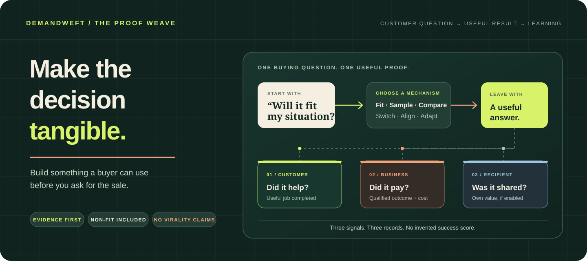

# Demandweft

<div align="center">

**Give a buyer something useful before asking for the sale.**

Build a proof experience around one real buying question. Then measure customer value, business outcomes, and optional sharing as separate things.



[Install the skill](#install) · [Run the checks](#verify-the-package) · [Read the method](skills/demandweft/SKILL.md) · [Open an issue](https://github.com/ufodia/demandweft/issues)


</div>

---

## The idea

Demandweft guides an AI coding assistant through shaping one unresolved buying question into a **usable proof experience**: a fit explorer, same-logic sample, decision comparison, switch rehearsal, coordination aid, or portable result.

The experience must help someone decide—even when the honest answer is **“not suitable,” “we need more information,” or “choose another option.”** The offer stays visible, the usefulness comes first, and a purchase is never treated as proof that the experience helped.

```text
customer question  →  useful proof  →  bounded learning
                           │
               ┌───────────┼───────────┐
               value     business    recipient
               kept      measured     optional
               separate  separately   and earned
```

Demandweft is an agent skill for founders, marketers, and builders working on products, SaaS, local services, and small businesses. It guides the host agent; tools, research access, implementation, and real-world results depend on the current environment.

## Choose the proof that answers the question

| A buyer is asking… | Build… | The person leaves with… |
| --- | --- | --- |
| “Is this right for my situation?” | **Fit explorer** | A reasoned suitable, unsuitable, or needs-clarification result. |
| “Will it work on something like mine?” | **Same-logic sample** | A bounded result made with the actual implementation or verified delivery method. |
| “How does this compare with my alternatives?” | **Decision comparator** | An editable view of evidence, assumptions, and unknowns. |
| “What could go wrong if I switch?” | **Switch rehearsal** | A reversible trial, visible differences, and restoration steps. |
| “How can we decide together?” | **Coordination artifact** | A brief or checklist another stakeholder can use independently. |
| “Can someone else adapt this result?” | **Portable result** | A resettable starting point that produces a separate result for its recipient. |

Use one mechanism at a time. Sharing is optional; it belongs only when the next person has a real job and receives their own value.

## A worked example, fictional on purpose

A volunteer host is planning a small community lunch and cannot tell which guest needs are still unanswered. The included [sample contract](skills/demandweft/assets/contract.example.json) turns that uncertainty into a keepable worksheet: mark date, venue, attendance, access, food and timing items as confirmed or unknown; then give each open item an owner and deadline. A host can still keep or print the worksheet when the event falls outside its scope. Ticketing, regulated catering, emergency planning and large-event operations route to a qualified specialist.

The contract keeps the business question and optional recipient outcome separate. Its planned measures are a future-pilot design, not observed results. The example is explicitly fictional; the [validator](skills/demandweft/scripts/validate_contract.py) checks structure and evidence references, not customer need, worksheet usability, or market demand. There is no running event-planning product in this package.

Use it as a pattern, then replace the scenario with an anonymized buying question you can support with real evidence.

## What makes the workflow different

- It carries a **customer question** through to a usable deliverable, not just a campaign idea.
- It gives **non-fit and unknown results** a clear, respectful route.
- It records **customer usefulness, qualified business outcomes, and recipient value** independently.
- It makes **time, cost, capacity, evidence quality, and uncertainty** visible before a test.
- It preserves negative results and precommits the next decision, including an inconclusive path.

This is a specific combination of established ideas. Free tools, customer discovery, proof-based positioning, remixing, and controlled experiments have prior art. The [bounded comparison and source notes](skills/demandweft/references/novelty-and-sources.md) explain the intended distinction; they do not establish a world first, trademark clearance, or commercial exclusivity.

## Install

Copy the complete `skills/demandweft/` folder into one host location. Keep `SKILL.md`, `references/`, `scripts/`, `assets/`, and `agents/` together.

| Host | Project install | User install | Invoke |
| --- | --- | --- | --- |
| Claude Code | `.claude/skills/demandweft/` | `~/.claude/skills/demandweft/` | `/demandweft` |
| Codex CLI / IDE extension | `.agents/skills/demandweft/` | `~/.agents/skills/demandweft/` | `$demandweft` |

For a project install, place the folder inside the project so teammates can version it with their work. A user install applies only to sessions on that machine. Cloud and account-level skill availability follow each host's own settings. These paths were checked against the [Claude Code skill guide](https://code.claude.com/docs/en/skills) and [OpenAI's skill guide](https://learn.chatgpt.com/docs/build-skills) on 2026-11-17.

### Start with one of these prompts

**Build a useful sample**

```text
Use $demandweft for our CSV import product. Inspect the real import function
and the supplied support questions. Build a small same-logic sample with a
usable output file and an honest unsupported-input path. We have four operator
hours and no paid-media budget. Prepare it for review; leave publication pending.
```

**Find the right-fit path**

```text
Use $demandweft for this bicycle workshop. Use the attached service list and
anonymized inquiry notes to build a fit explorer with suitable, unsuitable,
and needs-clarification outcomes. Keep correct routing separate from qualified
attended appointments.
```

**Review an experiment**

```text
Review this Demandweft contract and observation log. Separate customer benefit,
qualified business outcomes, and recipient value. Check the design, data quality,
and costs before interpreting results. Recommend a bounded follow-up, revision,
stop, or inconclusive result; preserve earlier negative evidence.
```

## Verify the package

The two production helpers use Python 3.9+ and the standard library. They read local JSON, print JSON, and do not call the network or modify the supplied input. Their output is a structural or arithmetic aid—not evidence that claims are true, tracking is valid, an experiment is causal, or a result is profitable.

Run from the release root, the directory containing this README:

### Windows PowerShell or Command Prompt

```powershell
py -3 -B skills\demandweft\scripts\validate_contract.py skills\demandweft\assets\contract.example.json
py -3 -B skills\demandweft\scripts\experiment_math.py skills\demandweft\assets\experiment.synthetic.json
py -3 -B -m unittest discover -s skills\demandweft\scripts -p "test_*.py" -v
py -3 -B tools\verify_release.py
```

### macOS, Linux, or another POSIX shell

```sh
python3 -B skills/demandweft/scripts/validate_contract.py skills/demandweft/assets/contract.example.json
python3 -B skills/demandweft/scripts/experiment_math.py skills/demandweft/assets/experiment.synthetic.json
python3 -B -m unittest discover -s skills/demandweft/scripts -p 'test_*.py' -v
python3 -B tools/verify_release.py
```

The contract fixture is fictional. The experiment fixture is synthetic and must always remain `demo_only`, regardless of the arithmetic it produces. `validate_contract.py` exits `0` for structurally ready-for-review, `1` for an incomplete draft, and `2` for invalid input. The math helper exits `0` when it has analyzed an input—including synthetic, blocked, and inconclusive results—and `2` for invalid input. Neither is an authorization check.

`verify_release.py` checks the SHA-256 entries in `CHECKSUMS.sha256` and reports regular release files missing from the manifest. Exit `0` means the listed bytes match and the release file set is covered; `1` means a listed file is missing or changed; `2` means the manifest or command is invalid/incomplete. The manifest intentionally does not hash itself. An integrity pass does not prove provenance or safety.

## Read the right detail

| If you are… | Read… |
| --- | --- |
| Choosing an intervention | [Mechanisms](skills/demandweft/references/mechanisms.md) |
| Building the artifact | [Build guide](skills/demandweft/references/building.md) |
| Defining observations | [Instrumentation](skills/demandweft/references/instrumentation.md) |
| Setting or interpreting a test | [Measurement](skills/demandweft/references/measurement.md) and [experiment math](skills/demandweft/references/experiment-math.md) |
| Writing a machine-readable contract | [Contract schema](skills/demandweft/references/contract-schema.md) and [example](skills/demandweft/assets/contract.example.json) |
| Preserving learning across iterations | [Learning record template](skills/demandweft/assets/learning-record.template.md) |

## Evidence boundaries

Demandweft does not promise sales lift, profitable acquisition, or virality. A polished demo, passing tests, AI persona feedback, and share-button clicks are not market validation. The bundled math helper supports one narrow case: a two-arm independent binary comparison with declared assumptions; it is not designed for clustered, paired, sequential, multi-arm, or non-binary data. Read [its method and limits](skills/demandweft/references/experiment-math.md) before interpreting a result.

Preparing an asset is separate from publishing it, contacting people, spending money, changing prices, collecting payments, or exposing an experiment. The skill produces reviewable work and states what remains pending. Use a platform's own workflow for live account operations.

## A question to take into your next product meeting

> **What could a buyer try, compare, or take away before they say yes?**

If this question improves your next brief, adapt the pattern and share the repository with the teammate who is tired of hand-wavy claims.

## Keep it useful

If a buying question feels familiar, adapt the workflow and synthetic example for your own context. If something breaks or a boundary is unclear, [open an issue](https://github.com/ufodia/demandweft/issues) with a minimal, non-sensitive example, the command you ran, its output, and what you expected. A useful contribution can also be a new fit/not-fit case with its evidence limits written down. Please do not include private customer records.

Independent tools from the same studio: [selimoglu.org](https://selimoglu.org) · [support on Buy Me a Coffee](https://buymeacoffee.com/ufodia)

---

<p align="center"><sub>Made by <a href="https://github.com/ufodia">ufodia</a> · MIT licensed · Evidence before hype</sub></p>
